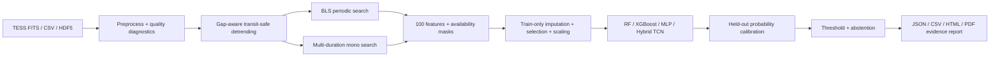

# exoplanet_ml

A scientifically conservative TESS light-curve triage pipeline for periodic
transits, isolated transit-like events, and major false-positive classes. It
combines signal search, interpretable features, calibrated classification,
abstention, uncertainty reporting, and reproducible host-grouped evaluation.

## Pipeline



The reported confidence is the calibrated probability of the reported model
class. Observation quality, template agreement, entropy, probability margin,
and ensemble or dropout uncertainty remain separate diagnostics; they are not
arbitrarily averaged into a probability.

## Quick Start

```powershell
python -m venv .venv
.venv\Scripts\Activate.ps1
python -m pip install -r requirements.txt
python -m pytest
python -m compileall -q src scripts tests train.py inference.py
```

Build and validate a versioned feature table:

```powershell
python scripts/build_dataset.py --config configs/config.yaml
python check_dataset.py --config configs/config.yaml
```

Train only after the checker passes:

```powershell
python train.py --config configs/config.yaml
python scripts/evaluate.py --config configs/config.yaml --test data/processed/features/test.csv
```

Run single-target or memory-bounded batch inference:

```powershell
python inference.py path\to\lightcurve.fits --config configs/config.yaml
python scripts/batch_inference.py --input-dir path\to\fits --config configs/config.yaml
```

## Data Contract

Raw files live in `data/raw/<class_alias>/`. Labels are multiclass and
host-grouped. `unknown` means unverified provenance and is excluded from
supervised fitting by default; it is not a scientifically valid negative
class. A verified non-transiting target belongs in `quiet_star`. Augmented rows
may occur only in training, never validation or test.

The dataset builder exports a fixed 100-feature schema plus one availability
mask per feature. Unsupported quantities such as centroid blend evidence or a
bootstrap false-alarm probability remain `NaN` with mask zero. Preprocessing,
selection, and normalization are fit on the training partition only.

Model artifacts use an explicit versioned schema. Legacy feature tables and
models are intentionally rejected because their labels, preprocessing, and
calibration contracts are incompatible with the current implementation.

## Scientific Scope

BLS and mono search generate candidates; they do not validate planets. Physical
parameters are emitted only when the candidate significance and required
stellar metadata support them. Mono-event periods are explicitly prior-dependent.
The system abstains on low-confidence or high-entropy predictions.

This repository does not yet implement pixel-level centroid or difference-image
analysis, a full vespa-style validation probability, or mission-scale
injection-recovery completeness. Those are required before claiming survey-grade
planet validation. See [Scientific Audit](docs/scientific_audit.md) and the
[Execution Plan](docs/project_layout.md). For a progressive explanation from
the basic idea through the implementation, read the
[Executive And Technical Guide](docs/executive_and_technical_guide.md).

## Main Outputs

- `data/processed/features/{master_dataset,train,val,test}.csv`
- `data/models/model_meta.joblib`, preprocessing artifacts, model, calibrator,
  metrics, and run manifest
- `data/processed/figures/` evaluation diagnostics
- `data/reports/<target>_<timestamp>/` structured prediction evidence

The default random forest is the reliable small-data baseline. Use the hybrid
TCN only when enough independent hosts and complete real flux caches are
available, and retain it only if fixed-test calibration and class-wise metrics
justify the added complexity.
