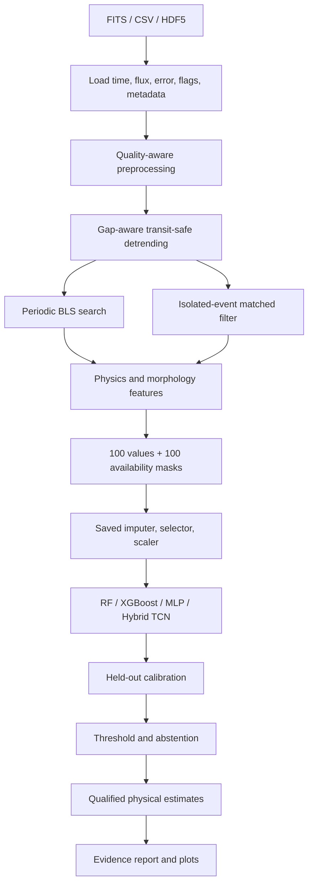

# Exoplanet ML: Executive And Technical Guide

This guide starts without assuming astronomy or machine-learning knowledge,
then progressively explains the physics, statistics, models, code modules, and
operational contracts behind the implementation.

## 1. Executive Summary

### Problem

TESS records the brightness of hundreds of thousands of stars. A planet may
reveal itself as a small dip when it crosses its star, but eclipsing stars,
background sources, stellar variability, spacecraft events, gaps, and noise can
produce similar patterns. Manual review does not scale, while an opaque model
with unjustified confidence can waste follow-up observations.

### Solution

This project is a physics-guided triage system. It reads a stellar light curve,
checks observation quality, removes slow trends without intentionally erasing
transits, searches for repeating and isolated dips, measures interpretable
evidence, classifies the target, calibrates the probability, estimates qualified
physical parameters, and generates an evidence report.

It can represent `planet`, `planet_candidate`, `eclipsing_binary`,
`background_blend`, `instrument_artefact`, `variable_star`, `quiet_star`, and
`unknown`. The broad `unknown` class is excluded from supervised fitting by
default because an unverified star is not a scientifically valid negative.

### What makes it different

- Physics search and ML cooperate; the model sees measured period, depth,
  duration, S/N, consistency, morphology, variability, and spectral evidence.
- Repeating transits and single-transit events use separate search branches.
- Unsupported evidence remains missing with an availability mask. The pipeline
  does not invent centroid evidence, stellar parameters, or false-alarm rates.
- Calibrated probability, observation quality, morphology, entropy, and model
  uncertainty remain separate quantities.
- The classifier can abstain when evidence is weak or contradictory.
- Host stars, not rows, define train/validation/test separation. Sectors and
  augmented copies cannot leak across evaluation boundaries.
- Artifacts store feature version, class mapping, selected schema, calibration,
  operating threshold, configuration, and checkpoint signature.

### Intended value

The software ranks and explains targets for expert review and follow-up. It is a
candidate detector and triage platform, not a replacement for astrophysical
validation. Its value is turning a large collection into a smaller, defensible
queue with reasons, uncertainty, and explicit failure states.

### Current state

The software pipeline is complete and its central contracts are covered by 32
tests. The existing local feature table is not scientifically trainable: it uses
schema `1.0.0` and its small class contains only five independent hosts. The
code correctly refuses it. New catalog-verified data must be rebuilt under
schema `2.0.0` before model performance is claimed.

## 2. Layman's Mental Model

Imagine recording a distant streetlight every few minutes.

- A planet is a small object passing in front, causing a shallow dip that often
  repeats on schedule.
- An eclipsing binary is one star crossing another. Its dips are often deeper,
  can alternate in size, and may include a second eclipse.
- A variable star changes its own brightness, often smoothly or at several
  frequencies.
- An instrument artefact comes from the camera or spacecraft.
- A background blend occurs when another source inside the same image aperture
  contributes the dip.

The pipeline asks four questions:

1. Is this observation usable?
2. Is there a coherent repeating or isolated dip?
3. Which measurements support each possible explanation?
4. Is the model certain enough to classify, or should it abstain?

## 3. Architecture



A significant periodic detection takes precedence. Otherwise a significant
mono event can define the candidate branch. If neither is significant, the
candidate type is `none`.

## 4. Input Contract

### FITS

Original TESS mission FITS is preferred. `src/data_loader.py` chooses columns
explicitly:

| Quantity | Priority |
|---|---|
| Time | `TIME` |
| Flux | `PDCSAP_FLUX`, then `SAP_FLUX`, then `FLUX` |
| Error | `PDCSAP_FLUX_ERR`, then `SAP_FLUX_ERR`, then `FLUX_ERR` |
| Quality | `QUALITY`, when present |

PDCSAP is preferred because it includes mission systematics correction. Target,
sector, camera, CCD, time reference, crowding, aperture fraction, stellar mass,
stellar radius, and temperature are preserved when headers provide them.

### CSV and HDF5

Minimum CSV:

```text
time,flux
0.0000,1.0002
0.0014,0.9998
```

Flux may be named `pdcsap_flux`, `flux`, or `sap_flux`; recognized error columns
are optional. HDF5 requires `time` and `flux`, with optional `flux_error`. Input
time is expected in days and flux must use one consistent scale.

### Labels

Training files live under `data/raw/<class_alias>/`. Aliases are defined in
`configs/config.yaml`. Every label needs catalog provenance or documented
review; a directory name alone is not scientific evidence.

## 5. Outcomes And Outputs

| Condition | Behavior |
|---|---|
| Hard quality failure | Prediction unavailable; failure reason and metrics remain in the report. |
| Usable curve, no significant dip | Candidate type `none`; quality and features remain available. |
| Periodic detection | Period, epoch, depth, duration, S/N, SDE, and sampled-event count. |
| Isolated detection only | Mono epoch, depth, duration, empirical S/N, morphology, and coverage. |
| No model loaded | Candidate generation and features only; no class probability is fabricated. |
| Confident classification | Calibrated probabilities, class, explanations, and qualified parameters. |
| Low top probability or high entropy | Abstention; reported class `unknown` and confidence zero. |
| Missing stellar metadata | Dependent physical quantities remain unavailable. |

Single inference may emit authoritative `prediction.json`, compact CSV and text,
HTML/PDF reports, and raw, cleaned, detrended, periodogram, phase-fold,
residual, and explanation plots. Final confidence is the calibrated probability
of the reported class. Quality and template scores are separate diagnostics.

## 6. Signal Processing Pipeline

### 6.1 Preprocessing

`src/preprocessing.py` records raw provenance, applies the TESS quality bitmask,
drops non-finite time or flux, deduplicates timestamps, sorts time, normalizes
flux, and performs asymmetric robust clipping.

```text
F_norm = F / median(F)
sigma_MAD = 1.4826 * median(|F - median(F)|)
```

Positive spikes are clipped by default. Negative clipping is disabled because a
transit is a negative excursion and symmetric clipping can erase the signal.

### 6.2 Quality assessment

`src/quality.py` separates hard usability failures from a descriptive score.
Checks cover point count, missingness, quality flags, cadence coverage, gaps,
robust scatter, stationarity, and cadence regularity. The score answers "is this
observation usable?", not "is this a planet?"

### 6.3 Detrending

`src/detrending.py` splits at large gaps and estimates slow trends per segment
with a day-based Savitzky-Golay or moving-median window. Iterative negative-dip
protection interpolates likely transit samples before re-estimating the trend.

```text
F_detrended(t) = F_observed(t) / Trend(t)
```

The trend window must exceed transit duration. A short window can fit away a
real dip. A regression test checks that an injected transit retains its depth
within 20 percent in the tested scenario.

### 6.4 Periodic BLS search

`src/transit_search.py` uses Astropy Box Least Squares. It compares repeating
box-shaped dips with a flat model over trial periods and physically allowed
durations. The grid is uniform in frequency because phase error accumulates in
frequency over a fixed observing baseline:

```text
frequency = 1 / period
```

Detection requires positive depth, minimum depth S/N, minimum robust signal
detection efficiency, enough independently sampled events, and enough points
inside each counted event.

```text
SDE = (peak_power - median_power) / robust_scale(power)
```

Durations are searched in period bands so physically impossible long-duration
trials are skipped. Reported period uncertainty is a local peak-width and
timing approximation, not a Bayesian posterior.

### 6.5 Mono-transit search

`src/mono_search.py` scans geometric event durations using a vectorized box
matched filter. Cumulative sums evaluate window means without repeatedly
slicing the full curve. Noise comes from the empirical distribution of all
same-duration windows, allowing correlated variability to increase the noise
estimate.

A candidate needs time coverage, multiple in-event points, minimum depth and
S/N, and coherent symmetric morphology. Non-maximum suppression prevents the
same event appearing at many nearby durations. Tests reject a single deep bad
cadence and recover a coherent injected event.

### 6.6 Phase folding

For period `P` and epoch `t0`:

```text
phase = ((time - t0) / P) modulo 1
```

Measurements from many orbits overlap. Repeating transit structure becomes
clearer while unrelated noise usually does not. Binned profiles support shape,
odd-even, secondary-eclipse, and template measurements.

### 6.7 Features and masks

`src/feature_extraction.py` emits exactly 100 features. With masks enabled, the
raw model vector has 200 columns: one value and one availability bit for each
feature.

Feature groups include period, depth, duration, epoch, S/N, SDE, sampled-event
count, event consistency, odd-even difference, measured secondary eclipse,
phase morphology, residuals, scatter, MAD, skewness, kurtosis, quantiles,
autocorrelation, gap-safe spectral variability, template similarity, mono-event
measurements, and measured stellar or contamination metadata.

Unsupported values such as pixel-level blend evidence or bootstrap FAP remain
`NaN` with mask zero. The imputer later supplies a numerical value, while the
mask preserves the fact that no measurement existed.

## 7. Physics Behind The Output

### Depth and radius ratio

For a small dark planet crossing an undiluted star:

```text
depth approximately equals (Rp / Rstar)^2
Rp / Rstar approximately equals sqrt(depth)
```

Depth uncertainty is propagated through the square root. The report warns that
dilution, limb darkening, and luminous companions weaken this approximation.

### Orbit and absolute planet radius

With period `P`, stellar mass `Mstar`, and negligible planet mass:

```text
a^3 = G * Mstar * P^2 / (4 * pi^2)
Rp = (Rp / Rstar) * Rstar
```

No stellar mass means no semi-major axis. No stellar radius means no absolute
planet radius. The code does not substitute solar values silently.

### Impact parameter

The implementation inverts circular-orbit total-duration geometry using period,
duration, radius ratio, stellar radius, and semi-major axis. It does not use an
unrelated heuristic. Circular orbit and box-duration assumptions are attached
to the estimate.

### Temperature, probability, and insolation

For configured Bond albedo and full heat redistribution:

```text
Teq = Teff * sqrt(Rstar / (2a)) * (1 - albedo)^(1/4)
P_transit approximately equals (Rstar + Rp) / a
```

Insolation uses stellar radius and temperature to scale luminosity, divided by
orbital distance squared. These are model-derived quantities, not direct
measurements of an atmosphere.

### Mono-event period

A single event does not reveal recurrence directly. The estimator samples
stellar uncertainty, a transiting impact-parameter prior, and an optional Beta
eccentricity prior, then applies configured period limits. Its intervals are
explicitly prior-dependent.

## 8. Machine-Learning Logic

### 8.1 Leakage control

`src/datasets/splits.py` groups by host star. Every sector and augmented copy of
one host stays in one partition, augmented rows are removed from validation and
test, and conflicting host labels raise an error.

Default use is 70 percent training, 15 percent validation, and 15 percent final
test. Training learns model parameters. Validation controls early stopping,
calibration, hyperparameters, and operating threshold. Test is evaluation only.

### 8.2 Train-only transforms

`src/trainer.py` fits median imputation, near-zero-variance filtering,
deterministic near-correlation removal, and robust/standard/min-max scaling only
on training rows. The exact fitted objects are reused for validation, test, and
inference, preventing held-out information from changing the training space.

### 8.3 Model families

**Random forest:** the default 400-tree CPU baseline. Log-loss splits, balanced
class behavior, minimum leaf size, and feature subsampling provide robust
nonlinear tabular learning, tree explanations, and ensemble spread.

**XGBoost:** boosted decision trees for larger tabular datasets. It can improve
performance after careful tuning but is more sensitive to hyperparameters and
calibration.

**Feature MLP:** dense neural layers with dropout, AdamW, learning-rate
reduction, early stopping, mixed precision on CUDA, and gradient clipping.

**Hybrid TCN:** combines selected engineered features with a 1024-point flux
view. Dilated residual 1-D convolutions enlarge temporal context; average
pooling captures broad behavior and maximum pooling retains sparse events. It
is higher capacity and should be retained only if enough independent hosts and
fixed-test evidence justify it.

### 8.4 Imbalance and loss

Trees use balanced class behavior where supported. Neural models can use
cross-entropy or focal loss:

```text
focal_loss = -(1 - p_true)^gamma * log(p_true)
```

This emphasizes hard examples. Class weights are capped to avoid unstable
gradients from tiny classes. Synthetic smoke data test software execution only.

### 8.5 Calibration

A raw score is not automatically a probability. Calibration is fit on held-out
validation predictions only. Temperature scaling, Platt scaling, isotonic
regression, and identity are supported. Flexible isotonic calibration is
refused when class support is too small.

Temperature scaling divides log probabilities by learned temperature `T` and
applies softmax. `T > 1` softens overconfidence; `T < 1` sharpens an
underconfident model.

### 8.6 Transit threshold and abstention

```text
P_transit_like = P(planet) + P(planet_candidate)
```

With enough validation support, the threshold is selected using an F-beta
objective that emphasizes recall and respects a target recall. Otherwise the
default `0.5` is retained with a diagnostic reason.

The model abstains when top probability is below `0.55` or normalized entropy
exceeds `0.90`:

```text
entropy = -sum(p_i * log(p_i))
normalized_entropy = entropy / log(number_of_classes)
```

Abstention closes the transit gate and sets final confidence to zero while
retaining the internal top class for investigation.

### 8.7 Uncertainty and explainability

The report keeps distinct:

- calibrated class probability
- top-two probability margin
- normalized entropy
- random-forest tree-to-tree probability spread
- neural MC-dropout probability spread
- quality, template, and parameter-uncertainty diagnostics

Global behavior uses tree/permutation importance. Single-target reports use
tree SHAP where possible or gradient-times-input attribution for neural models.
The hybrid model can expose high-saliency temporal positions. These describe
model sensitivity, not astrophysical causation.

## 9. Training And Inference

### Build and validate

```powershell
python scripts/build_dataset.py --config configs/config.yaml
python check_dataset.py --config configs/config.yaml
```

The checker enforces schema, finite values, mask agreement, integer/in-range
labels, cache identity, processing version, host consistency, independent-host
support, split isolation, and no augmented validation/test samples.

### Train, evaluate, compare

```powershell
python train.py --config configs/config.yaml
python scripts/evaluate.py --config configs/config.yaml --test data/processed/features/test.csv
python scripts/benchmark.py --config configs/config.yaml
python scripts/hyperparameter_search.py --config configs/config.yaml --strategy optuna --max-trials 24
```

Training is refused unless at least two supervised classes have the configured
minimum independent hosts. Hyperparameter search leaves final test hosts alone.

### Inference

```powershell
python inference.py path\to\lightcurve.fits --config configs/config.yaml
python scripts/batch_inference.py --input-dir path\to\fits --workers 4
```

Inference restores artifact schema v2, active class order, imputer, selected
features, scaler, model architecture, calibrator, and threshold. Legacy bundles
are rejected. Batch inference streams files, records per-file failures, and
writes through a temporary output before atomic replacement. CUDA neural batch
inference uses one worker to avoid GPU model contention.

## 10. Evaluation Metrics

| Metric | Meaning |
|---|---|
| Macro F1 | Treats every class equally regardless of size. |
| Balanced accuracy | Average class recall. |
| Per-class precision | Fraction of predictions for a class that were correct. |
| Per-class recall | Fraction of real members of a class that were recovered. |
| PR AUC | Ranking quality for rare planet/candidate retrieval. |
| ROC AUC | Threshold-independent separation, but can flatter rare-class results. |
| NLL | Penalizes probability assigned away from the true class. |
| Brier score | Squared error of the full probability vector. |
| ECE/MCE | Gap between confidence and observed correctness. |
| Confusion matrix | Shows which physical classes are confused. |

Accuracy alone is unsafe. The obsolete local model reached about 97.4 percent
accuracy but only about 0.494 macro F1 because one class dominated.

## 11. Module Map

| Module | Responsibility |
|---|---|
| `src/utils.py` | Config validation, reproducibility, logging, light-curve contract. |
| `src/data_loader.py` | Explicit FITS/CSV/HDF5 loading and metadata. |
| `src/preprocessing.py` | Quality masks, filtering, normalization, safe clipping. |
| `src/quality.py` | Hard usability checks and quality diagnostics. |
| `src/detrending.py` | Gap-aware, transit-protected trend removal. |
| `src/transit_search.py` | BLS and optional TLS periodic search. |
| `src/mono_search.py` | Vectorized isolated-event search. |
| `src/phase_folding.py` | Orbital phase and binned profiles. |
| `src/feature_extraction.py` | Stable 100-feature schema and masks. |
| `src/mono_features.py` | Mono morphology and radius-ratio uncertainty. |
| `src/parameter_estimation.py` | Qualified periodic and mono physics. |
| `src/feature_selection.py` | Train-only variance/correlation filtering. |
| `src/models.py` | Tree factory, MLP, hybrid temporal model, flux resampling. |
| `src/trainer.py` | Transforms, optimization, calibration, threshold, artifacts. |
| `src/calibration.py` | Held-out calibrators and reliability metrics. |
| `src/evaluator.py` | Class, positive-class, calibration, explanation metrics. |
| `src/classifier.py` | Probability interpretation, gate, abstention, FP guidance. |
| `src/pipeline.py` | End-to-end runtime and uncertainty decomposition. |
| `src/reporting.py` | JSON/CSV/TXT/HTML/PDF evidence reports. |
| `src/visualizer.py` | Scientific and explanation plots. |
| `src/datasets/*` | Download, cache, augmentation, split, sampling, export. |
| `train.py` | Strict training entry point and scientific data gates. |
| `inference.py` | Versioned loading, local explanations, plots, reports. |

## 12. Reproducibility And Hardware

Python, NumPy, Torch, augmentation, split, and model random states use the
configured seed where supported. Artifacts record versions, global and active
class IDs, raw and selected feature names, model/training configuration,
calibration, threshold diagnostics, history, and checkpoint signature.

The target is an RTX 4060 with about 8 GB VRAM, 32 GB RAM, 200 GB SSD, and 2 TB
HDD. Random forest is the practical CPU baseline. The hybrid model uses compact
1024-point input, mixed precision on CUDA, pinned transfer memory, gradient
clipping, and early stopping. Active caches belong on SSD; raw/archive products
can live on HDD. Streaming batch inference avoids loading a survey into RAM.

One measured real-file pipeline run improved from about 7.9 seconds to about 2.8
seconds after period-banded BLS. Mono scanning is vectorized and per-target
caches avoid repeated search.

## 13. Reliability And Scientific Limits

The 32 tests cover transit-safe preprocessing, depth-preserving detrending,
period/SNR/SDE recovery, coherent mono recovery, single-cadence rejection,
exact circular geometry, deterministic mono priors, missing-feature masks,
train-only transforms, class mapping, host leakage, augmentation containment,
calibration support, abstention, config rejection, independent-host support,
and evaluation without invented planet classes.

Run:

```powershell
python -m pytest
python -m compileall -q src scripts tests train.py inference.py check_dataset.py
python -m pip check
```

The largest remaining capability gap is pixel-level vetting: centroid motion,
difference images, aperture dependence, nearby-source analysis, and cross-sector
consistency. Before deployment or comparative claims, the project needs a
catalog-linked deduplicated dataset, an external host holdout, injection-recovery
tests across period/depth/noise/variability/crowding, domain-shift analysis, and
manual review of confident errors.

## 14. One-Minute Explanation

The system takes a TESS brightness time series and asks whether small dips are
real, repeatable, transit-shaped, and physically plausible. Physics-based search
measures the signal first. A leakage-safe ML model compares that evidence with
planets and major false positives. Its probability is calibrated on unseen
validation stars, and it can refuse ambiguous cases. Reports keep quality,
probability, uncertainty, and assumptions separate so a reviewer understands
both the conclusion and its limits. The software is ready for a new verified
dataset; the old imbalanced dataset is correctly blocked.

## 15. Glossary

| Term | Plain meaning |
|---|---|
| Light curve | Star brightness measured over time. |
| Transit | Dip when an orbiting body crosses its star. |
| Cadence | Time between measurements. |
| Detrending | Removing slow variation while retaining short events. |
| BLS | Search for a repeating box-shaped dip. |
| Phase fold | Overlay many orbital cycles into one cycle. |
| S/N | Signal strength divided by estimated noise. |
| SDE | How exceptional the best periodogram peak is. |
| Mono transit | One event with no measured recurrence. |
| False positive | Non-planet process resembling a transit. |
| Availability mask | Bit indicating whether a feature was measured. |
| Calibration | Aligning probabilities with observed frequencies. |
| Entropy | Probability spread across competing classes. |
| Abstention | Refusal to classify ambiguous evidence. |
| Leakage | Held-out information influencing training. |
| Injection-recovery | Add known transits and measure recovery. |
